# 동선을 처음 보는 사람도 알게: 안 셋 (2026-11-23)

이재엽의 말: "디자인에 신중할것 / 동선이나 루틴에 저렇게 작업한다고 하면 사람들이 이해하기 어려울것임 더 쉽게 작업"

이 문서는 **안**이다. 코드는 고치지 않았다. 쓰는 사람은 CES 연수에 가는 팀원(학생 ~ 장년)이고, 앱 설명을 읽지 않는다고 본다. 고를 것은 맨 끝에 있다.

- 지금 화면 그림: `docs/디자인/그림/지금-*.png` (배포판 https://gamercross.github.io/ces-2027/ , 2026-11-23, 360 × 740, 관심 회사 12곳 · 내 일정 하나를 넣고 찍음)
- 안 그림: `docs/디자인/그림/안-*.png`, 원본은 [동선_쉽게_목업.html](동선_쉽게_목업.html) (색 · 글꼴은 `web/tokens.css`와 같은 값, 밝게 · 어둡게)
- 기준: [design.md](../../design.md)(무채색 + 강조색 하나, 검정 단추는 화면에 하나, 숨기는 층 없음), ui-ux-pro-max(화면에 주 단추 하나 · 처음부터 다 보이지 않게 · 44px), design-taste-frontend 앱 화면 규칙(화면의 질문 하나가 가장 커야 한다 · 가장 잦은 일은 한 번에)

## 1. 지금 화면에서 막히는 곳

센 값(밝게, 글자 기본): 동선 첫 화면(스크롤 전)에 **누를 곳 13개**, 동선 화면 전체 25개(키 1472px, 두 번 굴려야 끝), 회사 카드 **23개**(Abbott: 부스 둘 · 강연 둘), "차례 정리" 카드 11개.

| 지금 그림 | |
|---|---|
| 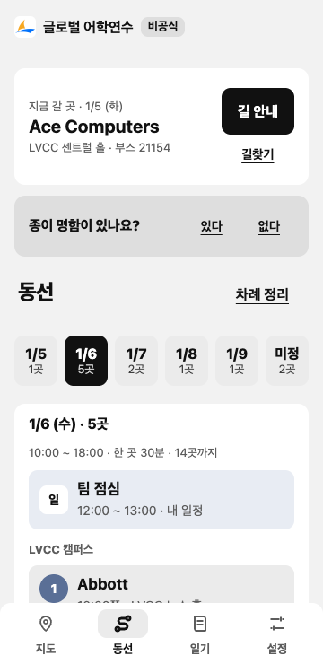 | 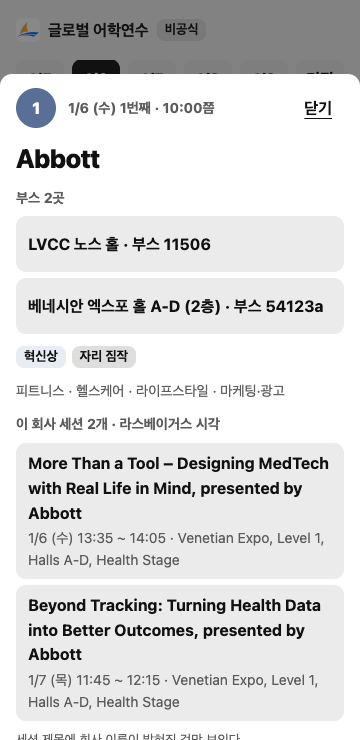 |
| 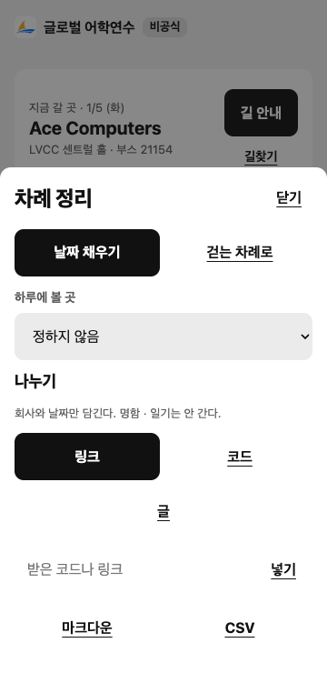 | 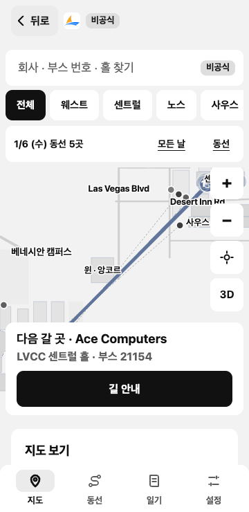 |

### 1.1 한 화면에 날짜가 둘, 질문이 셋

| 막히는 곳 | 왜 막히나 | 이렇게 바꾸면 안다 |
|---|---|---|
| 맨 위 "지금 갈 곳 · 1/5 (화) Ace Computers" 아래에 고른 날은 1/6 | 위와 아래가 다른 날을 말한다. 1/5는 전시장을 열기 전이라 "지금 갈 곳"이 맞지 않다 | "지금 갈 곳"은 **고른 날**의 첫 안 간 곳만 보인다 |
| 지도 "이 날 보기"(1/6)에서도 아래 띠가 "다음 갈 곳 · Ace Computers"(1/5 회사) | 1/6만 본다고 했는데 다른 날 회사로 길 안내를 건다 | 띠도 그 날 회사만, 없으면 띠를 안 보인다 |
| "종이 명함이 있나요? 있다 · 없다"가 동선 맨 위 | 동선과 상관없는 물음이 갈 곳보다 먼저 보인다 | 명함을 처음 만들 때 한 번 묻거나 설정의 명함 줄로 옮긴다 |
| 1/5 칩에 회사 1곳 | 전시장이 안 연 날에 회사를 넣을 수 있다 | 1/5 칩은 그 날 넣은 내 일정이 있을 때만 보이고, 회사 카드의 날짜 고르기에서는 뺀다 |

### 1.2 뜻 모를 말 · 칩 · 기호

| 지금 말 | 왜 막히나 | 이렇게 바꾸면 안다 |
|---|---|---|
| 탭 · 제목 "동선" | "움직이는 길"이라는 말이 젊은 사람에게 낯설고, 무엇을 하는 탭인지 안 보인다 | "갈 곳" (고를 것 2) |
| "길 안내"와 "길찾기"가 나란히 | 둘이 무엇이 다른지 모른다(앱 지도 vs 구글맵) | 단추는 "길 안내" 하나. 구글맵은 길 안내를 누른 뒤 필요할 때(다른 캠퍼스 · 전시장 밖) 지도에서 나온다(지금도 그렇다) |
| "차례 정리" | 누르면 무엇이 나올지 모른다. 안에 보내기까지 들어 있다 | "목록 고치기" |
| "날짜 채우기" · "걷는 차례로" | 무엇을 채우는지, 누가 걷는지 모른다 | "날짜 없는 곳을 날마다 나누기" · "가까운 곳끼리 줄 세우기" |
| "코드" · "마크다운" · "CSV" · "링크" · "글" | 영어 줄임말 · 만드는 사람 말. 다섯이 다 보낸다 | "다른 사람에게 보내기" 한 단추 → 폰의 공유 창. 파일 꼴 고르기는 설정의 내보내기로 |
| 칩 "미정 2곳" | 무엇이 안 정해졌는지 모른다 | "날짜 없음 2곳" |
| "10:00 ~ 18:00 · 한 곳 30분 · 14곳까지" | "14곳까지"가 정한 것인지 막는 것인지 모른다 | "10시 ~ 18시 · 하루에 14곳쯤 볼 수 있다" |
| 내 일정 줄의 동그라미 "일" | 번호 자리에 글자 하나라 회사 번호와 헷갈린다 | 점선 칸 "12:00 ~ 13:00 · 팀 점심 (내 일정)", 번호 없음 |
| 줄의 "LVCC 노스 홀 · 14731" | 숫자가 부스 번호인지 모른다 | "부스 14731"(낱말을 살린다) |
| 줄 오른쪽 "아직" / "봤다" | 단추인지 상태인지 모른다. "아직"을 누르면 "봤다"가 되는 것을 모른다 | 네모 칸 + 아래 "다녀옴". 누르면 칸에 체크, 이름에 줄이 간다 |
| 칸 머리 "LVCC 캠퍼스" · "베네시안 캠퍼스" | 영어 줄임말 + "캠퍼스"를 학교로 읽는다 | 홀 이름으로: "LVCC 노스 홀" (한 홀에 여럿이면 줄에서 홀을 뺀다) |
| 카드의 "자리 짐작" | 무엇의 자리를 누가 짐작했는지 모른다 | "자리는 짐작" (공식 배치도 전이라는 뜻, 지켜야 하는 표시는 그대로) |
| 카드의 "명함 이벤트" · "대화" · "로고 보기" | 셋 다 뜻을 알려면 써 봐야 한다 | 카드에서 뺀다(명함 이벤트는 지도 카드에만, 대화는 일기 쓰기 안에) |
| 아래 글자 링크 "추천 · 시간 · 내 일정 · 세션" | 화면 맨 아래라 안 보이고, "세션"은 영어다 | "강연 일정" · "추천 회사" · "내 시간" — 목록 고치기 아래 한 줄로 |
| 세션 일정 줄의 "넣기 · 나누기 · 공식 · 지도" | 무엇에 넣는지, "공식"이 무엇인지 모른다 | "내 일정에 넣기" 하나를 앞에, 나머지는 글자 둘("공식 쪽" · "지도") |
| 시간과 일정 칩 "시간 · 내 일정 · 파일" | "파일"을 누를 까닭을 모른다 | "파일"은 설정의 내보내기로 옮기고 칩은 둘 |
| 지도 띠 "1/6 (수) 동선 5곳 · 모든 날 · 동선" | 끝의 "동선"이 돌아가기인지 모른다 | "1/6 갈 곳 5곳만 보는 중 · 모두 보기" |
| 지도에 "비공식"이 두 번(머리 · 찾기 칸) | 같은 말 두 번 | 찾기 칸 안의 것 하나만 |

### 1.3 다음에 무엇을 누를지 모르는 곳

- **봤다 → 일기:** 회사를 다녀와도 일기 쓰라는 말이 없다. 일기는 회사 카드를 열고 아래로 굴려 작은 글자 "일기"를 찾아야 한다(세 번). → "다녀옴"을 누르면 아래에 "OO 다녀왔다 · 일기 쓰기"가 6초 뜬다(한 번).
- **줄을 누르면 큰 카드:** 카드 첫 화면이 부스 줄 둘 · 강연 둘로 차서 "길 안내" 단추가 굴려야 보인다. → 카드 첫 화면에 이름 · 부스 · 길 안내 · 다녀왔다 · 일기 쓰기.
- **검정 단추가 여럿:** "길 안내"(맨 위) 다음에 "차례 정리" 안에서 "날짜 채우기" · "링크"가 둘 다 검정이다. 무엇이 중요한지 흐려진다. → 화면에 검정은 "길 안내" 하나.

## 2. 쉬운 안 셋

세 안 모두 1.2의 말 바꾸기는 같이 한다. 다른 것은 **틀**이다.

### 안 1. 다음 한 곳 크게 + 오늘 목록 하나 (크기: 중간)

| 밝게 | 어둡게 ("다녀왔다" 바로 뒤) |
|---|---|
| 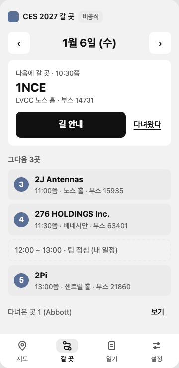 | 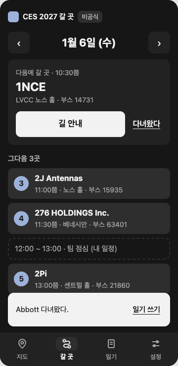 |

- 화면의 질문은 "지금 어디로 가지?" 하나. 가장 큰 것이 **다음에 갈 곳**(이름 24px · 부스 · 때 · 검정 "길 안내" · 글자 "다녀왔다").
- 날짜는 칩 여섯 대신 "‹ 1월 6일 (수) ›" 한 줄. 전시 날에는 오늘이 먼저 열린다.
- 그 아래 "그다음 3곳"(번호는 지도와 같다), 내 일정은 점선 칸으로 사이에. 다녀온 곳은 맨 아래 "다녀온 곳 1 · 보기" 한 줄로 접는다.
- 맨 아래 "목록 고치기 · 지도에서 보기". 목록 고치기 안에 날짜 나누기 · 줄 세우기 · 하루에 볼 곳 · 다른 사람에게 보내기 · 받은 목록 넣기.
- 바뀌는 것: 동선 탭의 그리기(`web/views/plan.js` `draw`) 거의 전부, 날짜 칩 → 한 줄, 줄의 "아직/봤다" 단추 → 큰 카드의 "다녀왔다"와 카드 안 단추, 띠(`alertBands`)를 동선 밖으로.
- 빠지는 것: 날짜 칩 줄과 칩의 곳 수(날마다 몇 곳인지 한눈에 보는 것), "안 본 곳" 칩(다녀온 곳이 저절로 접히므로 필요 없다), 줄마다 "봤다"를 바로 누르는 것(큰 카드나 회사 카드에서).
- 첫 화면 누를 곳 13 → 9.

### 안 2. 아침 · 점심 · 오후 세 칸 (크기: 크다)

| 밝게 | 어둡게 |
|---|---|
| 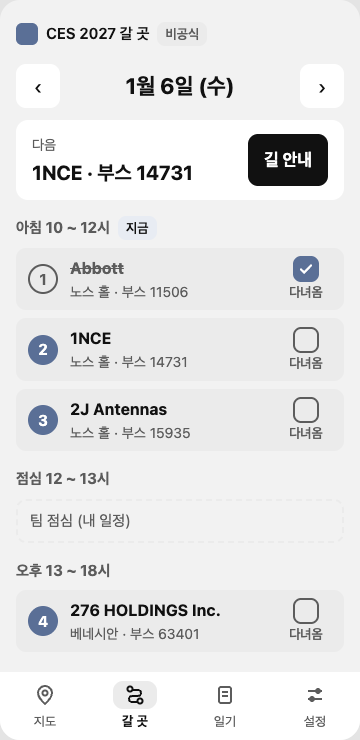 | 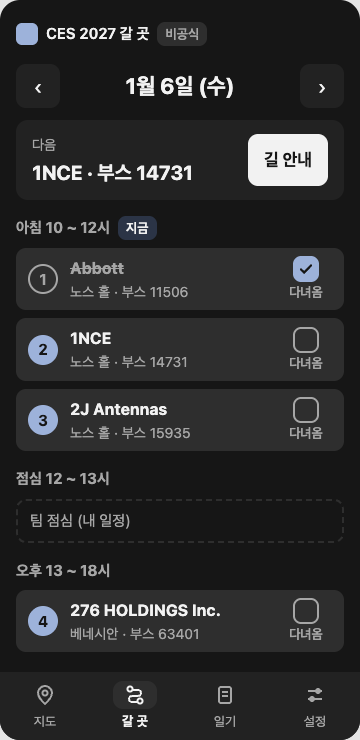 |

- 하루를 "아침 10 ~ 12시 · 점심 12 ~ 13시 · 오후 13 ~ 18시"로 나누고 지금 칸에 "지금" 표시만 붙인다. 칸 이름이 곧 때라서 줄마다 "10:30쯤"을 쓰지 않는다.
- 내 일정이 칸 사이에 자연스럽게 앉는다. 맨 위는 작은 한 줄 "다음 · 1NCE · 길 안내".
- 바뀌는 것: 때 셈(`web/days.js` `timeline`)에 칸 나누기를 더한다. 점심을 내 일정에 안 넣은 사람의 점심 칸, 공식 시간이 날마다 다른 것(1/6은 10시, 1/7은 9시), 1/5 · 날짜 없음(때가 없다)을 따로 그린다. 지도 번호와 칸 안 차례를 맞춘다.
- 빠지는 것: 날짜 칩 줄, 홀(캠퍼스) 묶음 머리(칸과 겹친다), "안 본 곳" 칩.
- 걱정: 한 곳 30분은 어림이다. 칸에 나누면 "11시에 꼭 가야 한다"로 읽혀, 늦어지면 칸이 틀린 것처럼 보인다. 현장에서 시간이 밀리는 일이 잦다.

### 안 3. 지금 틀 그대로, 말 · 단추만 줄이기 (크기: 작다)

| 밝게 | 어둡게 |
|---|---|
| 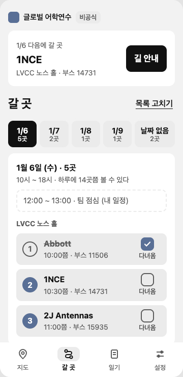 | 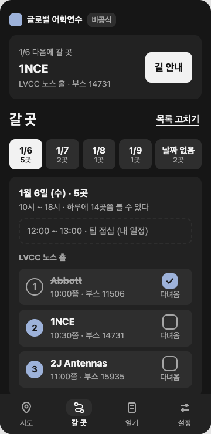 |

- 칩 · 줄 · 카드 틀은 그대로. 1.1과 1.2를 다 고친다: 위 "다음에 갈 곳"은 고른 날의 것, 종이 명함 물음은 동선 밖으로, "길찾기"는 빼고 길 안내 하나로, "차례 정리" → "목록 고치기", "미정" → "날짜 없음", 줄 오른쪽은 네모 칸 "다녀옴", 칸 머리는 홀 이름.
- 바뀌는 것: `plan.js`의 글자 · 단추 자리, `bands.js`를 동선에서 떼기, 지도 띠 글(`map.js`), 세션 줄 단추 글(`sessions.js`).
- 빠지는 것: 거의 없다. 화면 키는 비슷하다(첫 화면 누를 곳 13 → 11).

### 회사 카드 줄이기 (안 1 · 안 3 같이)

| 밝게 | 어둡게 |
|---|---|
| 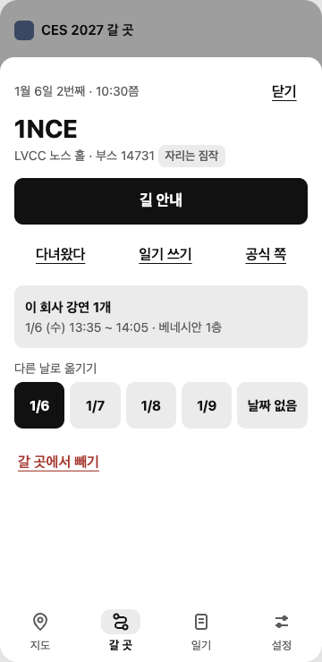 | 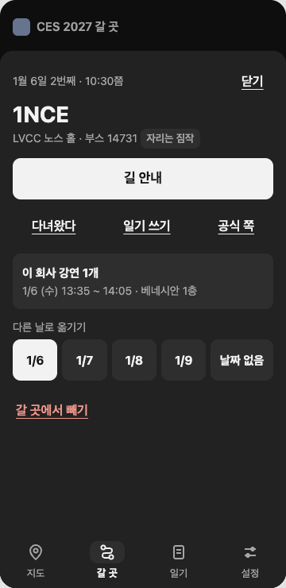 |

- 누를 곳 23 → 11(부스가 하나인 회사, 그림은 1NCE): 닫기 · 길 안내(검정) · 다녀왔다 · 일기 쓰기 · 공식 쪽 · 날짜 다섯 · 갈 곳에서 빼기. 이 회사 강연은 한 줄.
- 빠지는 것: 위로 · 아래로(차례는 목록 고치기에서), 대화, 명함 이벤트, 로고 보기, 구글맵 길찾기(길 안내를 누르면 지도 카드의 "여기까지 길"에 필요할 때 나온다).
- 부스가 둘 이상인 회사의 "자리마다 한 줄"(마무리 셋에서 정한 것)은 그대로 둔다. 그 줄은 길 안내 아래에 선다.
- 1/5는 날짜 고르기에서 뺀다(전시장이 안 연다).

### 세 안 견주기

| | 안 1 다음 한 곳 | 안 2 세 칸 | 안 3 말만 |
|---|---|---|---|
| 처음 본 사람이 "어디 가지?"를 아는 데 | 바로(가장 큰 것) | 바로(지금 칸) | 위 한 줄을 읽어야 |
| 첫 화면 누를 곳 | 9 | 10 | 11 |
| 날마다 몇 곳인지 한눈에 | 안 보인다(날짜를 넘겨야) | 안 보인다 | 보인다(칩) |
| 시간이 밀려도 맞는가 | 맞다(차례만 말한다) | 틀려 보인다 | 맞다 |
| 크기 | 중간 | 크다 | 작다 |
| 고칠 시험 | `browser-plan` · `browser-finish` · `smoke`의 동선 줄 | 위 + `days.js` 셈 시험 | `smoke` 글자 줄 몇 개 |

## 3. 지금 도는 일꾼의 PR과 겹치는 곳

| 일 | 지금 | 겹치는 곳 | 어떻게 |
|---|---|---|---|
| R47 "안 본 곳" 칩 (PR #82, 열림) | `plan.js` 날짜 칩 줄 끝에 칩 하나, 봤다 누를 때 상태 글, `smoke` · `browser-plan` · `browser-unseen` 시험, `app.css` | 안 1 · 안 2는 날짜 칩 줄을 없애서 이 칩이 설 자리가 없다(다녀온 곳을 접는 것이 같은 일을 한다). 안 3은 칩을 두고 이름만 "안 간 곳만"으로 | 안 1을 고르면 #82를 병합하기 전에 정한다: 병합하고 안 1에서 걷거나, #82를 닫고 안 1에 "다녀온 곳 접기"로 넣는다 |
| R48 공식 링크 목록 내보내기 (아직 안 지음, 차례는 #82 뒤) | 차례 정리의 나누기 칸에 단추 하나가 더 붙을 자리 | 안 1 · 안 3은 나누기 다섯을 "다른 사람에게 보내기" 하나로 묶는다. 여섯째 단추를 더하면 다시 늘어난다 | R48은 설정의 내보내기 줄 또는 "다른 사람에게 보내기" 안에 넣도록 짓는 일꾼에게 알린다 |
| R46 · R49 (병합됨) | 설정 · 일기 | "일기 쓰기"로 가는 길(`#/diary/new/<회사>`)만 쓴다 | 겹침 없음 |
| 폰 확인 2차 남은 것 (A 새 판 다시 열기 · B 카드 위 굴림 · E 카드를 열면 맨 위부터 · F 찾기 결과가 카드에 가림. C · D는 #81로 병합됨) | `map.js` · `mapsheet.js` · `mapgesture.js` · `offline.js` · `sw.js` | 지도 "이 날 보기" 띠 글과 "다음 갈 곳" 띠(`map.js`)를 이 안이 바꾼다. 회사 카드 줄이기를 지도 카드에도 하면 `mapsheet.js`(E)와 같은 파일 | 지도 쪽 말 바꾸기는 폰 고치기 PR이 병합된 뒤에 판다. 동선 카드(`plancard.js`)만 먼저 해도 된다 |
| 폰 확인 1차 "고치지 않은 것" 6 · 7 · 12 · 13 (디자인이 바뀌는 것) | 고르지 않음 | 7(세션 제목 말줄임)은 세션 줄 단추 글을 바꾸는 이 안과 같은 화면 | 같이 고를 수 있다 |
| 지켜 보는 시험 | `smoke.mjs` 409줄은 `plan.js`에 "지금 갈 곳"과 `alertBands(`가 있는지 본다. `browser-plan.mjs` 95줄은 차례 정리 단추가 8개인지 본다 | 세 안 모두 이 줄을 고쳐야 한다 | 고치는 PR에서 시험 글과 `design.md`의 UX 절 · 보드 앞면을 같이 고친다 |

## 4. 고를 것

1. **어느 안으로 갈까.** 추천은 **안 1(다음 한 곳 크게)** 이다. 까닭: 처음 보는 사람에게 필요한 답("지금 어디로")이 화면에서 가장 크고, 시간이 밀려도 틀리지 않으며, 다녀온 곳을 접는 것이 "안 본 곳" 칩 일을 같이 한다. 12월 첫 주 팀 시험 전에 넣으면 시험에서 바로 잴 수 있다. 빨리 끝내야 하면 안 3을 먼저 하고 안 1로 넘어가도 된다(말 바꾸기는 겹친다).
2. **탭 이름 "동선" → "갈 곳"을 바꿀까.** 네 탭 · 머리 · `design.md` · 보드 · 시험 글이 같이 바뀐다. 안과 따로 고른다.
3. **PR #82("안 본 곳" 칩)를 어떻게 할까.** 안 1이면 병합 전에 정한다(병합 후 걷기 / 닫고 안 1에 넣기).
4. **1/5를 회사 날짜에서 뺄까.** 1/5 칩은 마무리 셋에서 넣은 것이다. 내 일정(사전 일정)에는 두고, 회사를 1/5에 넣는 것만 막자는 안이다. 지금처럼 두면 "지금 갈 곳"만 고른 날로 맞춘다.

## 5. 이 문서를 만든 법

- 지금 그림: Playwright로 배포판을 360 × 740에서 열고, 이 폰 저장소에 지어낸 관심 12곳(1/5 1 · 1/6 5 · 1/7 2 · 1/8 1 · 1/9 1 · 날짜 없음 2, 1/6 둘째 곳은 "봤다")과 내 일정 하나(1/6 12 ~ 13시 팀 점심)를 넣고 찍었다. 누를 곳 수는 보이는 `a · button · select · input`을 셌다.
- 안 그림: `동선_쉽게_목업.html`을 같은 도구로 열어 폰 틀마다 찍었다. 회사 이름은 공식 전시사 자료의 실제 이름이고, 때와 점심은 지어낸 예시다.
- 실제 폰(아이폰 Safari)에서는 보지 않았다. 안을 고른 뒤 지을 때 폰에서 본다.
