# 편의성 점검 (2026-11-24)

이재엽의 말: "3D 지도랑 다른 지도랑 비교했을때 우리껄 사용해야하는 점? 사용자 편의성을 챙겼는지 확인해봐"

이 문서는 **점검과 안**이다. 코드는 고치지 않았다. 고를 것은 맨 끝(6절)에 있다.

- 본 판: 배포판 `2026-11-24-22cd05b` (PR #88 갈 곳 탭이 들어간 판). 처음에는 앞 판(`f1b346c`)을 보다가 새 판으로 다시 쟀다.
- 어떻게: Playwright(Chromium) 360 × 740, 밝게 · 어둡게 × 글자 기본(100%) · 가장 크게(150%) 네 가지. 시험용 관심 회사 여섯(1/6 다섯 · 1/7 하나)을 넣고 눌렀다. 위치는 처음엔 허락하지 않은 상태(브라우저 기본), 한 번은 허락해서 봤다.
- 잰 것: 누른 수 · 화면 수 · 엄지가 닿는지(단추 가운데가 화면 아래 3분의 1, 즉 위에서 493px 아래인지 · 44px 이상인지) · 화면에 보이는 글자 수(빈칸 빼고, 지도 위 글자는 따로) · 처음 보는 사람이 막히는 말.
- 기준: ui-ux-pro-max(44px · 엄지 · 한 화면에 주 단추 하나), design-taste-frontend 앱 화면 규칙(화면의 질문 하나가 가장 커야 한다), PELOVA 화면 규칙(대비 4.5:1 · 44px · 옆으로 밀리지 않음 · viewport), [design.md](../../design.md).
- 못 본 것: 실제 아이폰 Safari(주인이 쓰는 중), 실제 홀 안 GPS, 실제 폰 공유 창(시험에서는 공유 창을 가짜로 바꿔 보낸 글만 받았다), 폰 키보드가 올라왔을 때 가리는 것. 느린 4G는 Chromium이 흉내 낸 값이다.

## 1. 한눈에

- **잘 된 것:** 인터넷을 끊어도 지도 · 갈 곳 · 일기 · 설정 · 3D가 다 열린다. 느린 4G 흉내에서 첫 화면 1.0초, 지도 1.5초. 네 가지 모두 옆으로 밀리지 않고, 화면 안의 단추는 거의 다 44px 이상이다. 받은 링크를 열면 "6곳 가운데 내게 없는 것 6곳 · 6곳 더하기"가 한 번에 뜬다. 한글 "삼성"으로도 찾는다.
- **가장 큰 막힘 둘:** ① 지도 카드에서 "관심 담기"만 누른 사람이 갈 곳을 열면 "이 날 넣은 곳이 없다"만 보인다(담은 회사는 "날짜 없음"에 있고, › 를 네 번 눌러야 나온다). ② 위치를 허락하지 않으면 길 안내 판은 "위치 권한을 거부했다…"와 "내 위치 잡기"(GPS를 다시 묻기)만 보이고, 실제로 풀 길인 부스 번호 칸은 두 화면 아래(위에서 1029px)에 있다.
- **3D:** 열리기는 하지만(2.6초) 길 선과 회사 이름이 사라지고, 가운데를 누르니 보던 노스 홀이 아니라 "베네시안 캠퍼스" 카드가 떴다. 현장에서는 2D가 "어디로"에 더 잘 답한다(3.3절).

## 2. 잦은 일 다섯

값은 밝게 · 글자 100% 기준이고, 150%가 다르면 괄호에 적었다. 어둡게는 배치가 같아 값이 같았다(대비는 PELOVA 점검 0건).

| 일 | 누른 수 | 화면 수 | 엄지가 닿나 (주 단추) | 글자 수 | 막히는 말 · 곳 |
|---|---|---|---|---|---|
| ① 회사 찾아 관심에 담기 | 3 (찾기 칸 → 결과 → 관심 담기) + 갈 곳에 보이려면 날짜 1 | 2 (지도 → 카드) | 찾기 칸 y 12 · 첫 결과 y 74: **안 닿는다**. 관심 담기 y 428(150%: 468): 가운데. 날짜 단추 y 520: 닿는다 | 지도 42(+지도 위 59) · 찾기 66 · 카드 136(150%: 124) | "관심 담기"와 "갈 곳에 넣기"가 따로 있다. 담으면 큰 단추가 글자 "관심 중 · 빼기"로 바뀐다. 카드 아래 "명함 이벤트 있음으로 표시" · "로고 보기" |
| ② 지금 어디로 가는지 보기 | 1 (아래 탭 "갈 곳") | 1 | 길 안내 y 227(150%: 256): **엄지 밖, 화면 위쪽 3분의 1 아래**. 다녀왔다 87 × 44 | 197 (150%: 156) | 관심만 담은 사람은 "이 날 넣은 곳이 없다"(막힘 1). 날짜를 넣은 사람에게는 화면의 질문이 하나라 바로 안다 |
| ③-가 부스까지 · 같은 홀 | 위치 허락 때 1 (길 안내). 허락 안 함: 1 + 굴리기 두 번 + 번호 넣기 + 맞추기 = 3 | 1 (지도, 길 판) | 내 위치 잡기 y 536: 닿는다. 부스 번호 칸 y 1029: **화면 밖** | 97 → 맞춘 뒤 196 | "위치 권한을 거부했다. 따라가기를 껐다. 브라우저 설정에서 허락하거나 부스 번호로 맞춘다." "450m · 걸어서 7분 · 서쪽 (짐작)" — 홀 안에서 서쪽을 아는 사람은 드물다. 가는 곳(3M)이 지도 밖에 있다 |
| ③-나 부스까지 · 다른 캠퍼스 | 3 (› 다음 날 → 길 안내 → 굴려서 구글맵) | 2 (지도 → 구글맵) | 길 판에는 "끝내기"만. 구글맵 길찾기 y 1249(150%: 1577): **두 화면 아래** | 104 | "2.0km · 다른 캠퍼스 · 걸어서 약 29분 또는 셔틀"은 좋다. 그다음 누를 것이 판에 없다 |
| ④ 다녀온 뒤 일기 쓰기 | 3 (다녀왔다 → 띠의 일기 쓰기 → 굴려서 폰에 남기기) + 본 것 적기 | 2 (갈 곳 → 일기 쓰기) | 띠 일기 쓰기 y 612: 닿는다. 폰에 남기기 y 945(150%: 1091): **화면 밖** | 띠 118 | 띠는 6초 뒤 사라진다(시험이 6초 넘게 재는 동안 띠가 없어져 한 번 멈췄다). 놓치면 회사 카드 → 일기 쓰기로 간다(2번 누름). 회사 칸은 다녀온 회사로 채워져 있다(좋다). 칸이 아홉이고 "본 것"만 꼭 적는 칸인데 저장이 맨 아래다 |
| ⑤-가 팀과 나누기 · 보내기 | 2 (+ 굴리기) (목록 고치기 → 다른 사람에게 보내기) → 폰 공유 창 | 2 (갈 곳 → 목록 고치기 창) | 목록 고치기는 갈 곳 맨 아래(100%에서 아래 탭 뒤). 보내기 줄 y 436: 가운데 | 목록 고치기 창 242 | 보내기가 "목록 고치기" 안에 있다 — 고치는 곳에 보내기가 있으리라 짐작하기 어렵다. 보낸 글에 "목록 코드: …"가 붙는다 |
| ⑤-나 팀과 나누기 · 받기 | 1 (받은 링크 열기 → 6곳 더하기) | 1 | 6곳 더하기: 아래 창, 닿는다 | 짧다 | 없다. 잘 된다 |
| (일기 보내기) | 1 (일기 탭 → 보내기) | 1 | 보내기 68 × 44 y 391 | 94 | 없다 |

그림(왼쪽부터 ① → ⑤):

| ① 찾기 | ① 담은 뒤 | ② 관심만 담았을 때 | ② 날짜를 넣었을 때 |
|---|---|---|---|
| 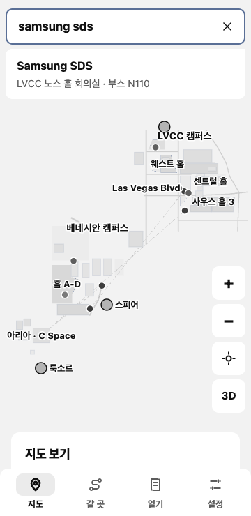 | 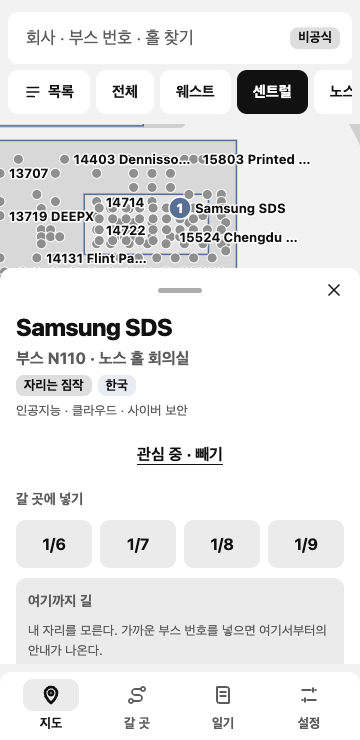 | 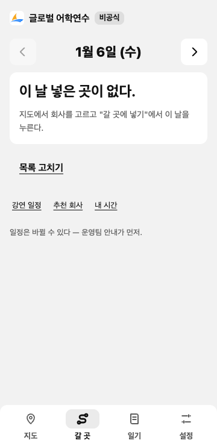 | 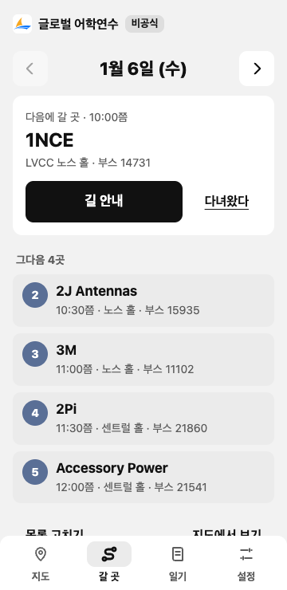 |

| ③ 위치를 모를 때 | ③ 부스 번호로 맞춘 뒤 | ③ 다른 캠퍼스 | ④ 다녀옴 띠 |
|---|---|---|---|
| 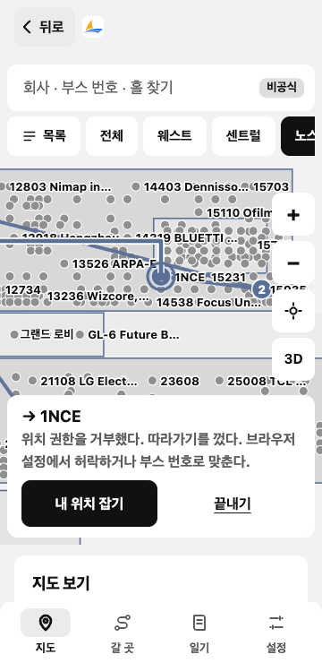 | 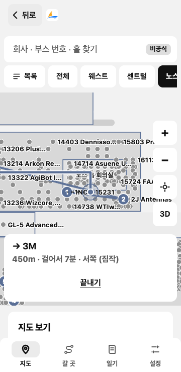 | 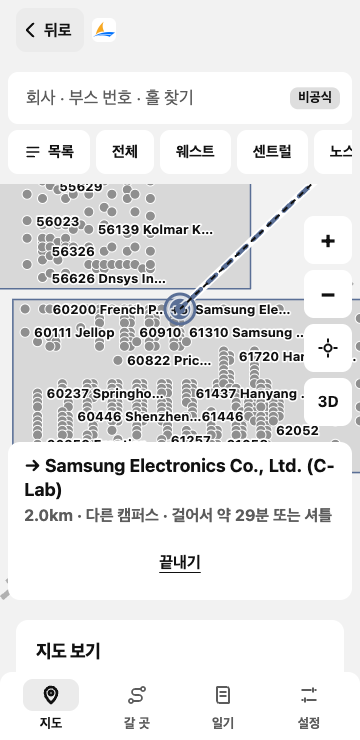 | 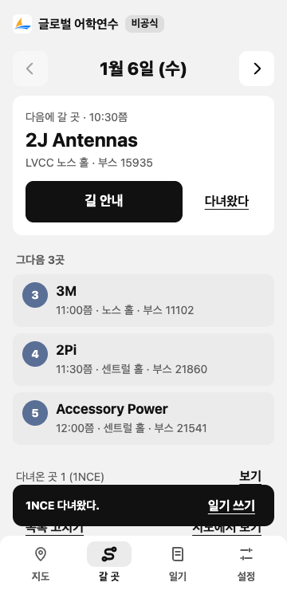 |

| ④ 일기 쓰기(저장은 화면 밖) | ⑤ 목록 고치기 안의 보내기 | ⑤ 받은 링크를 연 빈 폰 | 어둡게 150% 갈 곳 |
|---|---|---|---|
| 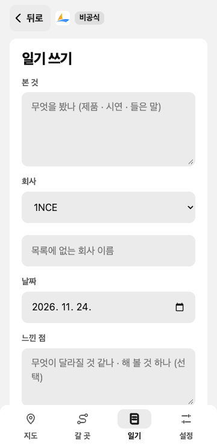 | 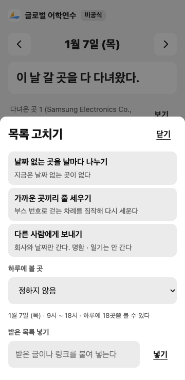 | 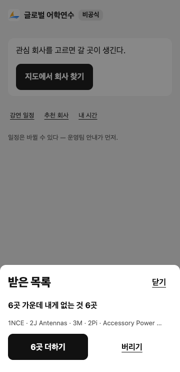 | 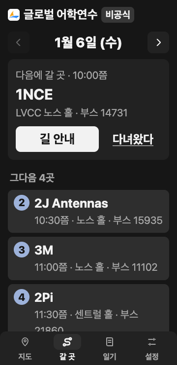 |

## 3. 그 밖의 편의

| 볼 것 | 본 것 | 판정 |
|---|---|---|
| 첫 실행 명함 | 100%: 별명 · 나(넷) · 명함 만들기가 한 화면, 만들기 y 517(닿는다). **150%: 명함 만들기가 아래 탭 뒤에 숨는다**(y 684, 굴려야 보인다). 명함을 만들기 전부터 아래 탭이 보인다. "나" 넷 가운데 "정년"이 낯설다(은퇴한 분이라는 뜻이 바로 안 읽힌다) | 일부 |
| 인터넷 없이 | 한 번 연 뒤 끊고 `#/map` · `#/plan` · `#/diary` · `#/diary/new` · `#/settings` · 이 날 지도 · 3D가 모두 열렸다. 설정에 "인터넷 없이 열린다 · 판 …"이 보인다 | 됨 |
| 느린 4G 첫 화면 | 흉내 값(1.6Mbps · 150ms, 저장 끔): 첫 글자 0.63초 · 명함 화면 1.0초(48KB) · 지도 1.5초. 빠른 줄: 0.2초 | 됨 |
| 큰 글자(150%)에서 가리는 것 | 명함 만들기 단추(위). 갈 곳 줄의 부스 번호가 둘째 줄로 내려가 아래 탭에 반쯤 걸린다(그림 06, 굴리면 보인다). 일기 저장 y 1091. 옆으로 밀림은 없다 | 일부 |
| 어둡게 | 길 안내가 흰 단추로 뒤집혀 화면에 하나다. 대비 어긋남 0(PELOVA). 그림 06 · 20 | 됨 |
| 빈 화면 말 | 갈 곳 아무것도 없을 때: "관심 회사를 고르면 갈 곳이 생긴다" + "지도에서 회사 찾기"(좋다). 일기: "일기 0개. 아래 '일기 쓰기'로 시작한다"(좋다). **찾기 결과 없음: "맞는 회사 · 강연이 없다."만** — 무엇으로 다시 찾을지 없다(그림 17). 받은 글이 틀렸을 때: "받은 글에서 회사를 찾지 못했다."(됨) | 일부 |
| 되돌리기 | 갈 곳에서 빼기 → 띠 "되돌리기"(87 × 44, 6초). 다녀왔다 → 띠에는 되돌리기가 없고, "다녀온 곳 · 보기"를 펴서 체크를 지운다. 관심 담기 → "관심 중 · 빼기" | 됨 |
| 위치 허용을 안 했을 때 | 길 판: "위치 권한을 거부했다. 따라가기를 껐다. 브라우저 설정에서 허락하거나 부스 번호로 맞춘다." 풀 길(부스 번호 칸)이 판 안에 없다(막힘 2). 허락했을 때: "250m · 걸어서 4분 · 남서쪽 (짐작)", 내 위치 "웨스트게이트 근처 (GPS, 짐작)" — 실외 GPS 어림이라 홀 이름이 틀릴 수 있다고 화면이 먼저 말한다(좋다) | 일부 |
| 다녀옴 띠 | 띠가 "목록 고치기 · 지도에서 보기" 줄을 6초 동안 덮는다(그림 10) | 작다 |
| 지도 칩 | 노스 홀 회의실 회사(Samsung SDS)를 열었는데 홀 칩은 "센트럴"이 켜진다(칩이 화면 가운데를 따른다, 그림 03) | 작다 |
| 글자 크기 고르기 | 설정 맨 위에 있다(아래 탭 → 단추 하나, 2번 누름). 보기 줄이 함께 바뀐다 | 됨 |

PELOVA 점검 범위: `pelova_design_check`는 design.md 색 대비만 보았다(대비 어긋남 0, 화면 파일은 0개를 읽었다). 화면 규칙(44px · 옆 밀림 · viewport · 4.5:1)은 위 Playwright 재기로 대신했다. viewport는 `width=device-width, initial-scale=1`(확대 막지 않음).

## 4. 지도 견주기

### 4.1 표

공식 앱 칸은 **글 근거**다. 2026-11-22 실제 공식 앱에서 지도 화면은 열리지 않았다([ces2026-앱-살펴보기.md](../참고/ces2026-앱-살펴보기.md) 5 · 7.3절). 구글맵 칸은 우리 앱이 구글맵으로 넘기는 일(Maps URLs)과 일반적인 구글맵 기능만 적었다.

| 견줄 것 | 우리 지도 (2D 기본 · 3D 단추) | CES 공식 앱 3D 실내 지도 | 구글맵 |
|---|---|---|---|
| 열 때 | 로그인 없음. 첫 화면 1초 안 | 로그인은 건너뛸 수 있으나 지도 화면을 열지 못했다(확인 못 함) | 로그인 없음 |
| 인터넷 없이 | **된다**(실측: 끊고 지도 · 3D까지 열림) | 확인 못 함 | 미리 받은 지도만(전시장 안은 확인 못 함) |
| 말 | 한국어, 회사는 영어 이름 그대로 + 한글로도 찾음 | 영어 | 한국어 |
| 부스 찾기 | 3,751곳을 이름 · 부스 번호 · 분야 · 홀로 | 검색에 전시사 · 세션 · 연사 · 위치 칸(결과는 못 봄) | CES 부스를 모른다(부스 자료가 없다) |
| 부스 자리 | **모두 짐작**(장소 31곳 모두 `guess`, 정식 배치도 0곳). 화면에 "자리는 짐작" | 공식 배치도 기반이라고 한다 | 없음 |
| 층 | 없음(홀마다 한 층으로 본다) | 여러 층 · 층 사이 안내(글) | 건물마다 다름(LVCC 실내는 확인 못 함) |
| 내 위치 | GPS + 부스 번호. 홀 안은 어림 | 파란 점 1 ~ 3m(회사의 말). LVCC · 베네시안 엑스포만, 블루투스 · 위치 허용 필요, 만달레이 베이 · 아리아 · 퐁텐블로는 안 됨(앱 안내문) | GPS(실내에서 흔들림) |
| 홀 안 길 | 짐작 선 + "450m · 걸어서 7분 · 서쪽 (짐작)" | 실내 길 안내(글) | 없음 |
| 다른 캠퍼스 · 밖 | 거리 · 걸어서 몇 분 · 셔틀을 말하고 구글맵으로 넘김 | 실내 · 실외 전환(글) | **가장 잘한다**(걷기 · 대중교통 · 차) |
| 내 갈 곳 | **번호(1 → 5)와 차례 선이 지도 위에**, 이 날만 보기 | 즐겨찾기 · 일정은 목록 화면. 지도에 차례로 그리는지는 확인 못 함 | 저장한 곳 핀만 |
| 칠해 보기 | 분야 · 한국 기업 · 혁신상 · 명함 이벤트 부스 | 확인 못 함 | 없음 |
| 셔틀 · 교통 | 노선과 오가는 법(출처 · 확인 날짜) | 교통 안내 + 실시간 대기(안내 글) | 실시간 교통 |
| 다녀온 뒤 | 다녀왔다 → 일기 쓰기 → 팀에 보내기로 이어짐 | 메모 칸 · 메모 보내기(로그인 뒤 일부) | 없음 |

### 4.2 우리 지도를 써야 하는 까닭 다섯

1. **내가 갈 곳이 지도 위에 번호로 있다.** 오늘 갈 다섯 곳이 1 → 5 차례 선으로 보이고, 아래 판이 "다음 갈 곳 · 길 안내"를 바로 준다(그림 14). 공식 앱은 목록 중심이고 지도는 열리지 않았고, 구글맵은 부스를 모른다.
2. **인터넷이 끊겨도 열린다.** 한 번 열어 두면 지도 · 갈 곳 · 일기 · 3D가 전파 없이도 뜬다(이번에 끊고 확인). 전시장 와이파이와 데이터가 막히는 때에 쓴다.
3. **로그인 없이 한국어로, 부스 번호로 바로 찾는다.** 3,751곳을 영어 이름 · 한글("삼성") · 부스 번호로 찾고, 카드 한 장에서 담기와 길 안내를 한다.
4. **다른 캠퍼스로 넘어가는 길을 이어 준다.** "2.0km · 다른 캠퍼스 · 걸어서 약 29분 또는 셔틀"을 먼저 말하고 셔틀 안내와 구글맵으로 넘긴다. 공식 앱의 실내 길은 LVCC · 베네시안 엑스포 안에서만이라고 안내한다.
5. **보는 데서 끝나지 않는다.** 한국 기업 · 혁신상 · 명함 이벤트를 지도에 칠해 고르고, 다녀오면 일기 → 팀 보내기로 이어진다. 받은 링크 하나로 팀원의 갈 곳을 내 지도에 더한다.

### 4.3 이럴 때는 공식 앱 · 구글맵이 낫다

1. **홀 안에서 부스 자리 · 층을 정확히 알아야 할 때 → 공식 앱.** 우리 부스 자리는 모두 짐작이고 층이 없다. 공식 앱은 공식 배치도와 현장 장비로 파란 점을 준다고 한다(우리가 직접 확인하지는 못했다).
2. **전시장 밖으로 오갈 때 → 구글맵.** 걷기 · 버스 · 차와 실시간 교통은 구글맵이 낫다. 우리 앱도 다른 캠퍼스에서는 구글맵으로 넘긴다.
3. **바뀐 일정 · 실시간 셔틀 대기 · 생중계 → 공식 앱과 운영팀.** 우리는 하루 한 번 받은 공식 자료라 그 사이 바뀐 것은 모른다.

### 4.4 우리 3D는 쓸모가 있나

| 2D (이 날 보기) | 3D (같은 날) | 3D 가운데를 누르면 |
|---|---|---|
| 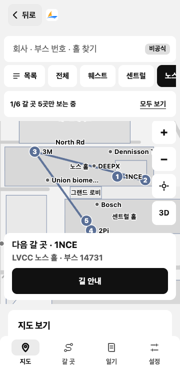 | 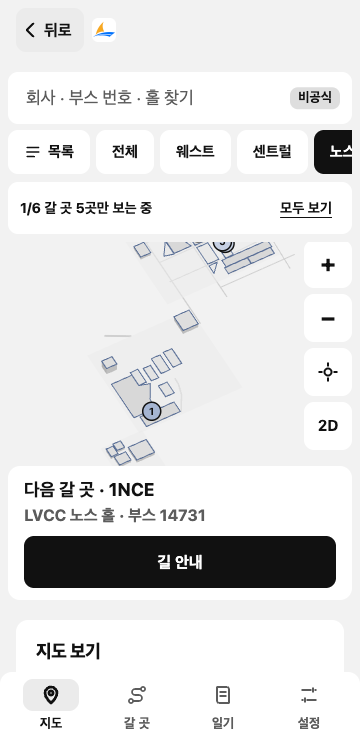 | 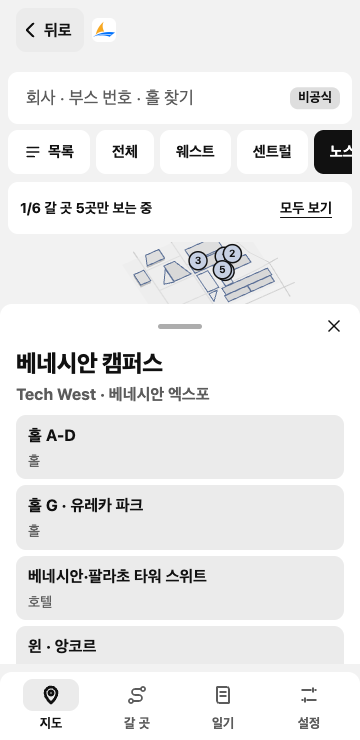 |

- 3D를 켜면 차례 선과 회사 이름이 사라지고 번호 동그라미만 겹쳐 남는다. 건물 모양은 보이지만 "다음은 어디로"에는 2D가 더 잘 답한다.
- 화면 가운데(노스 홀 근처로 보이는 곳)를 한 번 누르니 "베네시안 캠퍼스" 카드가 떴다. 보고 있던 곳과 다른 카드라 헷갈린다.
- 3D는 지도 탭에서 누를 때만 불러오고(2.6초), 인터넷 없이도 열렸다. 첫 화면을 무겁게 하지는 않는다.
- **판단:** 지금 3D는 현장에서 쓸모가 작고, 길 안내 중에 켜면 헷갈리게 한다. 기본 2D는 맞다. 3D는 "건물 모양 보기"로 남기되 길 안내 · 이 날 보기 중에는 단추를 숨기거나, 3D에도 차례 선과 다음 곳 이름을 그리는 것이 좋다(5절 7번).

## 5. 코디세이 QnA에서 빌릴 것 세 가지

배포판 https://sangukjeon.github.io/Codyssey_QnA/ 를 같은 360 × 740에서 열었다.

| QnA 첫 화면 | QnA 공지 안의 묻고 답한 것 |
|---|---|
| 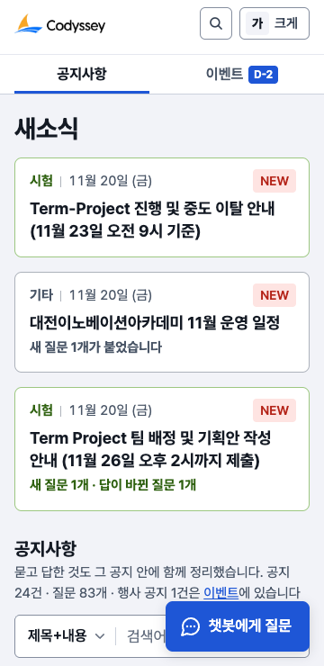 | 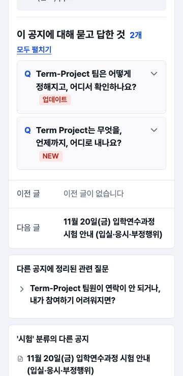 |

1. **카드 하나는 "작은 머리 한 줄 + 굵은 제목 + 상태 한 줄"만.** QnA 새소식 카드는 "분류 · 날짜 · NEW" / 제목 두 줄 / "새 질문 1개"뿐이다. 우리 지도 카드는 글자 136자에 단추 아홉(관심 담기 · 날짜 넷 · 길 안내 시작 · 내 자리 넣기 · 명함 이벤트 · 로고 보기)이다. → 카드 첫 화면은 "부스 · 홀 / 이름 / 담기 하나 · 길 안내 하나", 나머지는 아래로.
2. **답은 접고 질문만 보인다, 필요하면 "모두 펼치기".** QnA는 묻고 답한 것을 질문 줄로만 보이고 누르면 편다. → 일기 쓰기는 "본 것 + 폰에 남기기"만 보이고 느낀 점 · 사진 · 누구에게 · 대화는 "더 적기" 아래 접는다(저장이 첫 화면에 온다). 카드의 공식 쪽 · 명함 이벤트 · 로고도 "더 보기" 하나로 접는다.
3. **머리에 "가 크게" 단추, 탭 옆에 짧은 숫자.** QnA는 머리 오른쪽에 글자 크게 단추가 늘 있고, "이벤트" 탭 옆에 "D-2"가 붙어 왜 눌러야 하는지 숫자로 말한다. → 글자 크기를 설정 안이 아니라 머리에서 한 번에 바꾸게 하고(장년 팀원), "갈 곳" 탭 옆에 오늘 남은 곳 수를 붙인다.

빌리지 않을 것: QnA의 얇은 테두리 카드와 파랑 · 초록 · 빨강을 함께 쓰는 색. 우리 design.md는 면의 톤 차이와 강조색 하나다.

## 6. 모자란 것 (심한 순)

"겹침"은 갈 곳 탭을 만든 일꾼(PR #88, 안 1)의 몫과 겹치는지다. 그 PR은 병합 · 배포되어 이번에 새 판을 함께 쟀다.

| # | 어디 | 무엇이 불편 | 그림 | 고칠 안 | 크기 | 겹침 |
|---|---|---|---|---|---|---|
| 1 | 지도 카드 → 갈 곳 | "관심 담기"만 누르면 갈 곳 첫 화면이 "이 날 넣은 곳이 없다". 담은 회사는 "날짜 없음"(› 네 번 뒤)에 있다 | 03 · 04 | 빈 날 화면에 "날짜 없는 곳 1곳 · 보기" 줄을 띄운다. 또는 관심 담기를 누르면 고른 날(전시 때는 오늘)로 바로 넣고, 날짜 칩은 "다른 날로" | 중간 | 겹침 (갈 곳) |
| 2 | 길 안내 · 위치 허락 안 함 | 판에는 GPS 다시 묻기만 있고 부스 번호 칸은 두 화면 아래. 말도 길다 | 07 | 위치를 못 쓰면 판 안에 "가까운 부스 번호" 칸 + 맞추기를 바로 둔다. 말은 "위치를 못 쓴다. 가까운 부스 번호를 적는다." | 작다 | 아님 (지도) |
| 3 | 일기 쓰기 | 저장 단추가 화면 밖(y 945 · 150%: 1091). 칸 아홉 중 꼭 적을 것은 하나. 다녀옴 띠는 6초면 사라진다 | 10 · 11 | 다녀옴에서 열면 "본 것 + 폰에 남기기"만, 나머지는 "더 적기"로 접는다(QnA 2). 띠는 다음에 무엇을 누를 때까지 둔다 | 중간 | 띠만 겹침 |
| 4 | 길 안내 · 다른 캠퍼스 | 판에 "끝내기"만. 구글맵 · 셔틀은 두 화면 아래 | 09 | 판에 "구글맵으로 가기"(검정 하나) + "셔틀 보기" 글자 단추 | 작다 | 아님 |
| 5 | 길 안내 · 같은 홀 | "서쪽 (짐작)"은 홀 안에서 쓸모가 적다. 가는 부스가 지도 밖에 있다 | 08 | 방위 대신 "부스 번호가 작아지는 쪽으로 · 11102" 꼴로, 지도는 나와 가는 곳을 한 화면에 담는다 | 중간 | 아님 |
| 6 | 지도 찾기 | 찾기 칸(y 12)과 결과(y 74)가 엄지 밖. 찾기는 현장에서 가장 잦은 일이다 | 02 | 결과 목록을 아래 판으로 띄우거나, 아래 탭 "지도"를 한 번 더 누르면 찾기 칸에 글자를 놓는다 | 중간 | 아님 |
| 7 | 3D | 길 선 · 회사 이름이 사라지고, 가운데 누름이 다른 캠퍼스 카드를 연다 | 15 · 16 | 길 안내 · 이 날 보기 중엔 3D 단추를 숨기거나, 3D에도 차례 선 · 다음 곳 이름 | 작다 ~ 중간 | 아님 |
| 8 | 첫 실행 명함 | 150%에서 명함 만들기가 아래 탭 뒤. 만들기 전부터 탭이 보인다. "정년"이 낯설다 | 01 | 명함 전엔 아래 탭을 숨기고, 환영 두 줄을 한 줄로, "정년"은 "은퇴" 같은 쉬운 말로(이재엽이 고른다) | 작다 | 아님 |
| 9 | 나누기 | 보내기가 "목록 고치기" 안, 갈 곳 맨 아래(100%에서 아래 탭 뒤) | 12 | 줄 이름을 "고치기 · 보내기"로, 또는 갈 곳 머리에 "보내기" 글자 단추 | 작다 | 겹침 (갈 곳) |
| 10 | 지도 카드 말 | "관심 중 · 빼기", "명함 이벤트 있음으로 표시", "로고 보기"가 첫 화면에 | 03 · 20 | 담은 뒤에도 큰 단추 자리에 "담음" 상태를 두고, 명함 이벤트 · 로고는 "더 보기"로(QnA 1) | 작다 | 아님 |
| 11 | 찾기 없음 | "맞는 회사 · 강연이 없다."에 다음 할 일이 없다 | 17 | "영어 이름 · 부스 번호로도 찾는다" 한 줄 | 작다 | 아님 |
| 12 | 다녀옴 띠 | 띠가 "목록 고치기 · 지도에서 보기" 줄을 덮는다 | 10 | 띠가 뜰 때 아래 여백을 띠 높이만큼 늘린다 | 작다 | 겹침 (갈 곳) |
| 13 | 지도 칩 | 노스 홀 회의실 회사인데 "센트럴" 칩이 켜진다 | 03 | 카드를 열었을 때는 그 회사의 홀 칩을 켠다 | 작다 | 아님 |

## 7. 고를 것

이재엽이 고를 고칠 것, 추천 셋(위가 먼저):

1. **6절 1번 — 관심만 담아도 갈 곳에 보이게** (중간, 갈 곳 일꾼 몫과 겹침). 가장 잦은 첫 일(①)이 두 번째 일(②)로 이어지지 않는다.
2. **6절 2 · 4번 — 길 판 안에 다음에 누를 것** (작다 둘). 위치를 못 쓸 때 부스 번호 칸, 다른 캠퍼스일 때 구글맵 단추.
3. **6절 3번 — 일기 쓰기를 "본 것 + 저장"으로 줄이고 나머지 접기** (중간, QnA 2를 빌린다).

3D는 따로 정한다: 지금처럼 단추로 두되 길 안내 중에는 숨길지(작다), 3D에도 선과 이름을 그릴지(중간).

**정한 것 (11/24 이재엽, 버튼으로):** 추천 셋을 다 고친다(관심 → 갈 곳 · 길 판 단추 · 일기 줄이기, 하나씩 PR). 3D는 "3D에도 차례 선 · 이름 그리기". 첫 명함의 "정년"은 그대로 둔다.

## 8. 고친 뒤 다시 잰 값

같은 360 × 740 · 390 × 740, 밝게 · 어둡게, 글자 네 단계에서 Playwright로 다시 쟀다(책상 Chromium, 실제 아이폰은 쓰지 않았다). 전은 고치기 전 main, 후는 고친 가지다.

### 8.1 관심만 담아도 갈 곳에 보이게 (6절 1번)

관심만 담은 세 곳(날짜 없음), 보고 있는 날은 1/6.

| 잰 것 | 전 | 후 |
|---|---|---|
| 담은 회사가 보일 때까지 누른 수 | 4 (다음 날 › 네 번) | 1 ("날짜 없는 곳 3곳 보기") |
| 빈 날 화면에서 다음에 누를 것 | 없다(글 한 줄 "지도에서 회사를 고르고 …") | 검정 단추 하나, 296 × 52(390px: 326 × 52), 가운데 y 205(글자 가장 크게: 213) |
| 엄지가 닿나 | — | 화면 위쪽(엄지 밖)이다. "길 안내"가 서는 자리와 같다. 스크롤 없이 보인다 |
| 넣은 곳이 있는 날(1/6에 다섯, 날짜 없음 둘) | 알리는 것이 없다 | 다녀온 곳 줄 아래 한 줄 "날짜 없는 곳 2곳 · 보기"(보기 60 × 44, y 662 — 100%에서 아래 탭에 걸려 조금 굴려야 보인다. 줄이 적은 날은 굴리지 않아도 보인다) |
| 옆으로 밀림 · 검정 단추 수 | 0 · 0(빈 날) | 0 · 1(빈 날), 1(넣은 곳이 있는 날은 "길 안내" 그대로) |

| 전 (빈 날) | 후 (빈 날) | 후 (넣은 곳이 있는 날) | 후 (누른 뒤) |
|---|---|---|---|
|  | 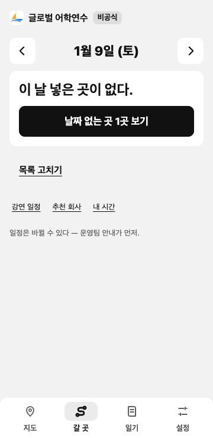 | 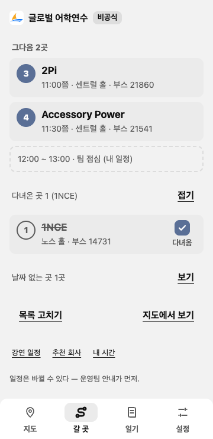 | 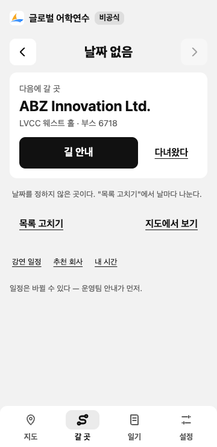 |

남은 것: 날짜 없는 곳에서 날짜를 고르려면 이름 → 카드 → 날짜로 두 번 누른다(줄마다 날짜 칩을 늘어놓지 않았다). 여러 곳을 한 번에 나누는 길은 "목록 고치기 → 날짜 없는 곳을 날마다 나누기" 그대로다.

### 8.2 길 판 안에 다음에 누를 것 (6절 2 · 4번)

길 안내를 켠 채(`#/map/go/<회사>`) 쟀다. 위치를 못 쓸 때는 위치를 허락하지 않은 브라우저, 다른 캠퍼스는 노스 홀 부스 번호로 맞춘 뒤 베네시안의 회사로 갔다. y는 화면 맨 위에서 잰 가운데 높이다(화면 740, 아래 탭 위까지가 보이는 곳).

| 잰 것 | 전 | 후 |
|---|---|---|
| 위치를 못 쓸 때 판의 말 | "위치 권한을 거부했다. 따라가기를 껐다. 브라우저 설정에서 허락하거나 부스 번호로 맞춘다." (두 줄) | "위치를 못 쓴다. 가까운 부스 번호를 적는다." (한 줄, 글자 가장 크게: 두 줄) |
| 부스 번호 칸이 있는 곳 | y 1055(글자 가장 크게: 1206) — **화면 밖**, 두 번 굴려야 보인다 | 판 안 y 502(가장 크게: 499), 226 × 52 — 굴리지 않는다. 엄지가 닿는다 |
| 내 자리를 맞출 때까지 | 길 안내 → 굴리기 두 번 → 번호 → 맞추기 | 길 안내 → 번호 → 맞추기(누른 수 2, 굴리기 0) |
| 판의 검정 단추 | "내 위치 잡기"(허락하지 않았으면 눌러도 풀리지 않는다) | "맞추기" 78 × 52 |
| 다른 캠퍼스일 때 판의 단추 | "끝내기"뿐 | "구글맵으로 가기"(검정, 163 × 52) · "셔틀 보기"(75 × 52) · "끝내기", 모두 y 562 |
| 구글맵 길찾기가 있는 곳 | y 1250(가장 크게: 1566) — **두 화면 아래** | 판 안 y 562(가장 크게: 502) |
| 셔틀로 가는 곳 | y 762(화면 밖, "셔틀 · 오가는 법") | 판 안 y 562(가장 크게: 502) |
| 같은 것이 두 곳에 있나 | — | 없다. 판에 칸 · 구글맵이 있는 동안 아래 묶음의 같은 칸 · 같은 단추는 숨긴다 |
| 옆으로 밀림 · 44px 못 미침 · 잘린 글자 · 보이는 검정 단추 | — | 0 · 0 · 0 · 1 (360 · 390px × 밝게 · 어둡게 × 글자 네 단계 16가지) |

| 전 (위치 못 씀) | 후 (위치 못 씀) | 후 (맞춘 뒤) | 전 (다른 캠퍼스) | 후 (다른 캠퍼스) |
|---|---|---|---|---|
|  | 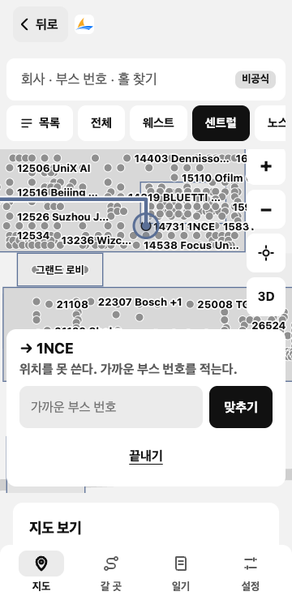 | 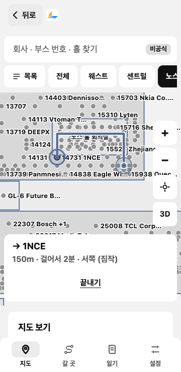 |  | 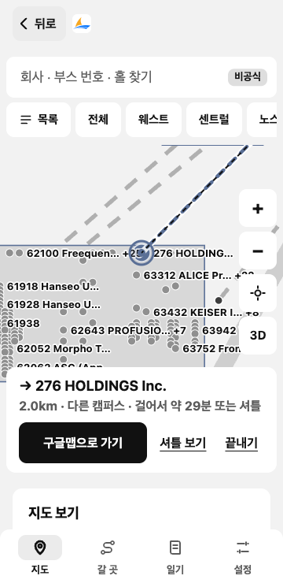 |

판에서 뺀 것: 위치를 못 쓸 때의 "내 위치 잡기". 허락하지 않은 브라우저는 다시 눌러도 묻지 않아 막힌 길이었다. GPS를 다시 묻는 단추는 아래 "내 위치" 묶음의 "GPS로 찾기"에 그대로 있다. 전시장 밖일 때의 "다시 잡기 · 구글맵 · 끝내기"는 그대로다.

남은 것: 큰 글자(가장 크게)에서 다른 캠퍼스 판은 "끝내기"가 둘째 줄로 내려가 판이 255px(전 195px)로 커진다. 지도는 그만큼 덜 보인다.

### 8.7 3D에도 차례 선 · 다음 곳 이름 (6절 7번)

1/6에 다섯 곳(노스 · 센트럴 홀), 1/7에 둘. "이 날 보기"에서 3D를 켰다.

| 잰 것 | 전 | 후 |
|---|---|---|
| 그 날 차례 선 | 없다 | 하나(번호 1 → 5 차례, 2D와 같은 강조색 · 굵기 4) |
| 읽히는 회사 이름 | 0 | 다음에 갈 곳 + 나머지 넷(가장 작은 글자 13px, 겹침 0. 글자 가장 크게는 16.9px) |
| 그 날 번호 다섯 가운데 읽히는 것 | 하나(나머지는 겹치거나 찾기 칸 뒤) | 다섯 모두(찾기 칸 아래 ~ 띠 위의 보이는 칸 안) |
| 화면 가운데를 누르면 | "베네시안 캠퍼스" 카드 | 손가락 아래의 "노스 홀" 카드 |
| 홀을 가까이 본 채 홀 밖 바닥을 누르면 | 캠퍼스 카드 | 아무것도 열리지 않는다(캠퍼스 카드는 캠퍼스 이름이 보일 만큼 멀리 볼 때만) |
| 길 안내 중 | 길 선이 없다 | 2D와 같은 길 선 · 가는 곳 이름, 띠의 "(짐작)" 그대로 |
| 3D 여는 시간(CPU 4배 · 느린 4G, 누른 때 ~ 그려진 때) | 0.22초(갈 곳 없으면 1.14초) | 0.34초(갈 곳 없으면 1.18초) |
| 인터넷 없이 | 열린다 | 열린다(차례 선 · 이름까지) |

| 전 | 후 | 전 (가운데 누름) | 후 (가운데 누름) |
|---|---|---|---|
|  | 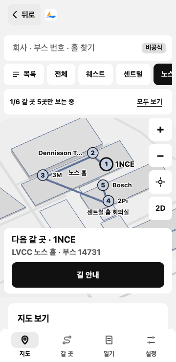 |  | 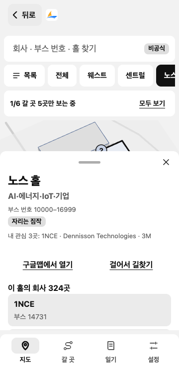 |

남은 것: 멀리(전체) 볼 때는 번호가 겹친다(2D도 같다). 실제 폰의 손가락 누름과 햇빛 아래 선의 또렷함은 사람이 본다.
